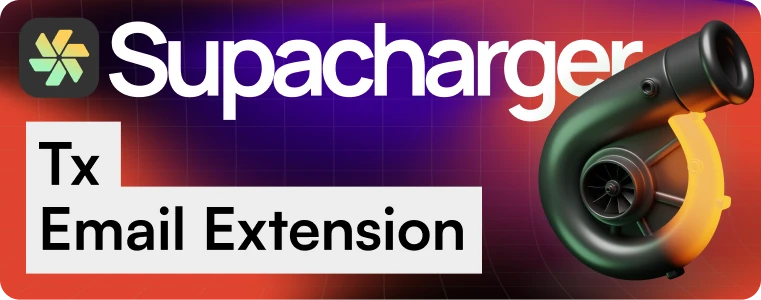

# supacharger-ext-transactional-email

Unified transactional email through Brevo API, Resend API, Mailgun API or authenticated SMTP. Core selects this extension as its service implementation; the developer-owned extension config selects one delivery transport.

Brevo uses hosted templates. Resend and Mailgun support hosted templates or rendered content. SMTP requires rendered subject and body. Each prepared worker imports only its selected adapter.

The private durable queue supports transaction-safe enqueue, eligibility rechecks, atomic leases, selected blocked recovery and conservative handling of ambiguous sends. Provider acceptance does not imply inbox delivery.

See [installation and API guidance](payload/docs/INSTALL.md) and [Bruno requests](payload/docs/bruno/). Run `npm install` and `npm run check` for source checks. Prepare an application with `node scripts/prepare.mjs /path/to/application <CLI-created-migration-filename>`; install its reviewed `.prepared/<namespace>` payload using Core’s local extension installer. Release/archive metadata is separate from local package preparation.
